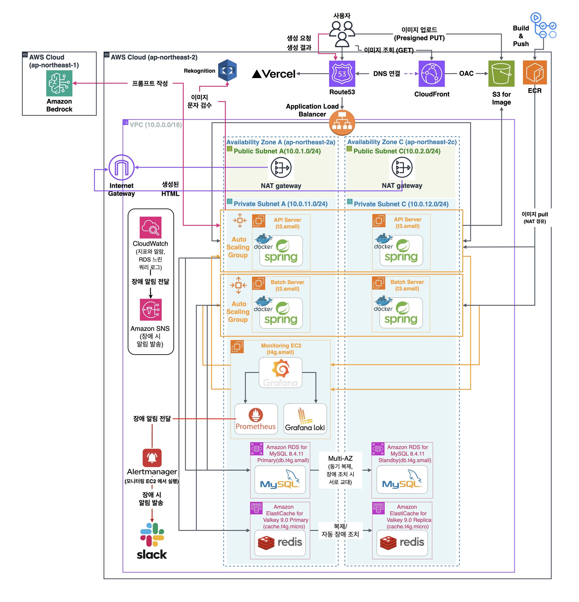
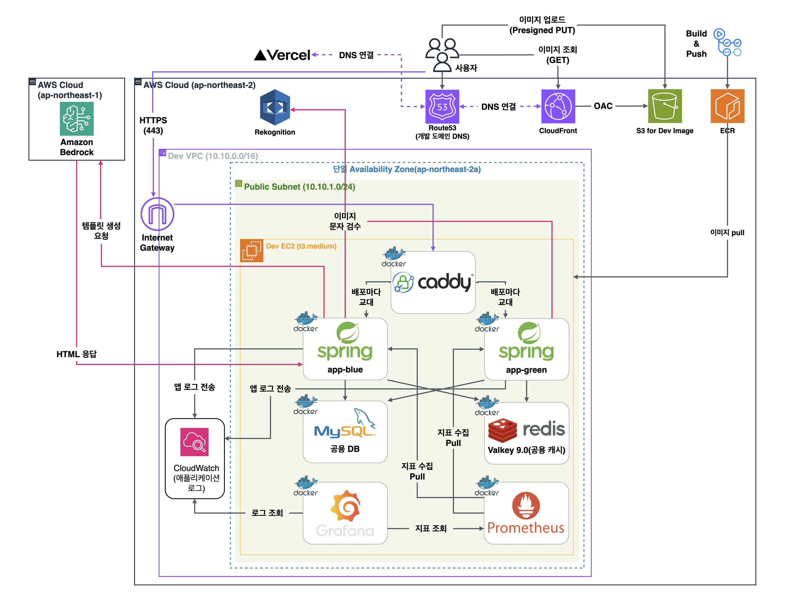

# lc-infra

런치캐치(lunch-catch) 백엔드의 인프라다. Terraform 으로 AWS 를 만들고, lc-backend 의 `main` 병합을 트리거로 운영에 배포한다.

## 아키텍처

### 운영



### 개발



그림의 draw.io 원본과 고치는 법은 [`docs/architecture/`](docs/architecture/) 에 있다.

## 한눈에 보기

| | 운영 | 개발 |
|---|---|---|
| 리전과 가용 영역 | 서울, 2a 와 2c 두 곳 | 서울, 2a 한 곳 |
| 네트워크 | 퍼블릭 서브넷에 ALB 와 NAT Gateway, 프라이빗 서브넷에 서버와 데이터 | 퍼블릭 서브넷 하나에 EC2 한 대 |
| 앱 | API 서버 t3.small 2대, Auto Scaling Group (2 ~ 3대) | EC2 t3.medium 한 대에 app-blue, app-green 컨테이너 |
| 배치 | 배치 서버 t3.small 2대, 두 대 모두 스케줄러를 켠 액티브-액티브 | 앱 컨테이너가 batch 프로필로 스케줄러까지 돌린다 |
| DB | RDS MySQL 8.4 Multi-AZ | 같은 EC2 의 MySQL 컨테이너 |
| 캐시 | ElastiCache Valkey 9.0, Primary 와 Replica | 같은 EC2 의 Valkey 컨테이너 |
| 이미지 | S3 + CloudFront (`cdn.lunchcatch.com`) | S3 + CloudFront (`cdn.dev.lunchcatch.com`) |
| 관측 | 모니터링 EC2 의 Grafana, Prometheus, Loki, Alertmanager | 같은 EC2 의 Grafana, Prometheus, 앱 로그는 CloudWatch Logs |
| 배포 | `deploy.sh` 롤링 배포 | caddy 뒤에서 blue 와 green 을 번갈아 띄운다 |
| Terraform 위치 | `envs/prod/` (모듈은 `modules/`) | `dev/` |

## 동작 흐름

**요청**

```
사용자 -> Route53 -> ALB -> API 서버 -> RDS, Valkey
사용자 -> CloudFront -> S3                (이미지 조회)
사용자 -> S3 presigned PUT                (이미지 업로드)
API 서버 -> NAT Gateway -> Bedrock, Rekognition, 카카오, 토스
```

**배포**

```
lc-backend main 병합 -> GitHub Actions 빌드 -> ECR push -> deploy.sh
  -> 앱 서버를 한 대 늘려 새 버전을 띄움 -> 헬스체크와 스모크 통과 -> 구 서버를 하나씩 내림 -> 배치 서버를 한 대씩 재시작
```

**lc-backend `main` 에 병합하면 바로 운영에 배포된다.** 배포 중 약 3분은 앱 서버가 1대로 줄어든다. 시연이나 촬영 중에는 병합하지 않는다.

**장애 알림**

```
Prometheus -> Alertmanager -> Slack            모니터링 인스턴스가 살아 있을 때
CloudWatch 알람, RDS 이벤트 -> SNS -> 메일     모니터링 인스턴스까지 죽었을 때
```

## 역할별 시작점

| 나는 | 먼저 볼 곳 |
|---|---|
| 팀원. 개발 서버에 붙거나 로컬에서 Bedrock 을 쓰거나 부하 시험을 한다 | [`docs/wiki/`](docs/wiki/) (GitHub 위키와 같다) |
| 인프라를 올리고 내리고 껐다 켠다 | [`docs/deploy/README.md`](docs/deploy/README.md) |
| 운영에 장애가 났다 | 같은 문서의 "장애가 나면 되돌린다". 롤백과 같은 버전 재배포를 가른다 |
| 왜 이렇게 정했는지 본다 | [`docs/system-design/`](docs/system-design/) |
| 코드가 결정과 맞는지 리뷰한다 | [`docs/infra-review/`](docs/infra-review/) |

## 저장소 구조

```
modules/         운영 AWS 리소스 정의. 아래 다섯 모듈로 나눈다
  network/         VPC, 서브넷, NAT, S3 엔드포인트, 보안 그룹
  data/            RDS, ElastiCache
  edge/            ALB, 인증서, DNS 레코드, 이미지 버킷과 CloudFront
  compute/         시작 템플릿, 앱과 배치 ASG, 모니터링과 부하 생성기, ECR, IAM, 런타임 SSM 값, 부팅 템플릿
  observability/   CloudWatch 알람, SNS, 예산
envs/            모듈을 조립하는 루트. 상태가 루트마다 따로다
  prod/            운영. 파괴 가드와 삭제 보호를 켠다
  lt/              팀원 부하 시험 한 벌. 삭제 보호를 끄고 정해진 시각에 스스로 지운다. member-env.sh 가 돌린다
dev/             개발 서버. 운영과 상태를 나눠 따로 올리고 내린다
bootstrap/       파괴를 견디는 계층. 상태 버킷, 시크릿, GitHub OIDC 역할, 도메인 호스팅 영역, 개발 ECR. 로컬 상태로 관리한다
observability/   모니터링 인스턴스에서 도는 것들. Terraform 이 아니라 git clone 으로 배포한다
scripts/         런타임을 다루는 것들. Terraform 이 건드리면 안 되는 영역이다
docs/            그림, 설계 근거, 배포 절차, 판정 기준
verify.sh        G-LOCAL 진입점. 본체는 common 저장소에 있다
```

**`bootstrap/` 이 따로인 이유**는 둘이다. 상태 버킷은 자기 자신을 상태에 담을 수 없어 닭과 달걀이고, 시크릿은 `destroy.sh` 를 견뎌야 한다. SSM 표준 파라미터는 무료라 지워도 아끼는 것이 없는데 지우면 재구축 때 전부를 손으로 다시 넣어야 한다. `./scripts/apply.sh` 가 두 구성의 순서를 흡수한다.

**운영과 부하 시험이 같은 모듈을 쓰는 이유**는 시험한 구성과 운영 구성이 갈라지지 않게 하기 위해서다. 차이(도메인, 삭제 보호, 자동 정리)는 `envs/lt` 가 변수로만 준다. 개발 서버(`dev/`)는 EC2 한 대 구성이라 모양이 달라 모듈을 쓰지 않는다.

**`observability/` 를 Terraform 이 갖지 않는 이유**는 알람 임계값을 고칠 때마다 `apply` 를 하지 않기 위해서다(`INF-32`, `OPS-2-18`). 모니터링 인스턴스가 이 저장소를 클론하고, 설정을 고치면 거기서 `git pull` 한다.

## 지켜야 할 규칙

**Terraform 과 스크립트의 경계.** 이 경계가 깨지면 배포가 깨진다.

| 대상 | 누가 |
|---|---|
| ASG, 시작 템플릿, 대상 그룹, 리스너, SSM 파라미터 **리소스** | Terraform |
| SSM 파라미터의 **값**, desired capacity, 대상 등록과 해제 | 스크립트 |

Terraform 쪽에 `ignore_changes` 를 걸어 두었다. 자세한 것은 [`docs/deploy/README.md`](docs/deploy/README.md).

**계정 가드.** 다른 AWS 계정에서 실수로 돌리지 않게 세 겹으로 막는다.

- `envs/prod/versions.tf` 가 `allowed_account_ids` 와 `profile` 을 함께 건다. 다른 계정 자격증명이면 plan 단계에서 `AWS account ID not allowed` 로 멈춘다.
- `scripts/` 는 `AWS_PROFILE` 이 비어 있으면 `lunchcatch` 프로필을 쓰고, 운영 계정이 아니면 시작 전에 멈춘다. CI 처럼 자격증명이 환경변수로 오면 프로필을 건드리지 않는다.
- `destroy.sh` 는 대상 계정 ID 를 사람이 직접 입력해야 진행한다.

**apply 는 plan 을 본 뒤에 한다.** `apply.sh` 는 `-auto-approve` 로 돈다. 공유 템플릿(`common-bootstrap.sh`, alloy 설정)을 고치면 배치 서버 교체와 모니터링 재시작이 함께 일어나므로 `terraform plan` 으로 범위를 먼저 확인한다.

## 스크립트

| 스크립트 | 언제 |
|---|---|
| `apply.sh` | 인프라를 올린다. bootstrap 순서, 시크릿 검사, 엔드포인트 반영을 흡수한다 |
| `deploy.sh` | `main` 병합 시 워크플로가 부른다. 인자 없이 직접 돌리면 `main` 최신을 배포한다 |
| `rollback.sh` | 이전 SHA 로 배포를 다시 한다. 사전 점검을 건너뛰고 ECR 이미지가 있는지 먼저 본다 |
| `preflight.sh` | 배포 직전 차단 게이트(G-RELEASE) |
| `stop.sh` / `start.sh` | 세션 단위로 껐다 켠다. 비용이 절반 정도 줄어든다 |
| `destroy.sh` | 전부 지운다. 오래 안 쓸 때 |
| `dev-up.sh` / `dev-down.sh` | 개발 서버를 켜고 끈다. 끄기는 삭제가 아니라 중지다 |
| `dev-db.sh` / `dev-logs.sh` | 개발 서버 MySQL 에 포트 포워딩으로 붙는다, 앱 로그를 본다. Windows 는 `.ps1` |
| `account-passwords.sh` | 기본 계정 비밀번호를 SSM 에 둔다 |
| `superadmin-password.sh` | superadmin 비밀번호를 SSM 값으로 맞춘다 |
| `account-password.sh` | 기본 계정 묶음(scenario, demo-owner, demo-admin, superadmin)의 비밀번호를 SSM 과 DB 에서 함께 바꾼다 |
| `reset-base-world.sh` | 기본 세계(시연 데이터)를 다시 넣기 전에 정리한다 |
| `member-env.sh` | 팀원이 자기 AWS 계정에 운영과 같은 인프라를 띄워 부하 시험을 한다 |
| `loadtest-box.sh` / `loadtest-snapshot.sh` | 부하 생성기를 띄우고 내린다, 회차 대시보드를 PNG 로 받는다 |

## 검증

```bash
terraform fmt -check -recursive modules envs
terraform -chdir=envs/prod init -backend=false && terraform -chdir=envs/prod validate
./verify.sh                  # G-LOCAL. 아직 push 하지 않은 커밋 전부
```

판정 항목은 `.github/llm-verify/items.yml` 이 갖는다. `docs/infra-review/*-guideline.md` 를 고치면 **재생성해야 한다.** 안 하면 `registry-check` 가 PR 을 막는다.

## 문서 지도

| 폴더 | 내용 |
|---|---|
| [`docs/architecture/`](docs/architecture/) | 운영과 개발 AWS 아키텍처 그림과 draw.io 원본 |
| [`docs/deploy/`](docs/deploy/) | 올리기, 배포, 롤백, 껐다 켜기, 지우기, 기본 세계 복원 절차 |
| [`docs/system-design/`](docs/system-design/) | 설계 결정과 근거. 장애 대응, 오토스케일링, 배치, 백업, 알람, 개발 서버, Bedrock |
| [`docs/infra-review/`](docs/infra-review/) | 코드, 운영, 배포 직전 점검 기준과 보류한 결정 |
| [`docs/verification/`](docs/verification/) | 검증 기준 |
| [`docs/wiki/`](docs/wiki/) | 팀원용 안내. GitHub 위키로 동기화된다 |
