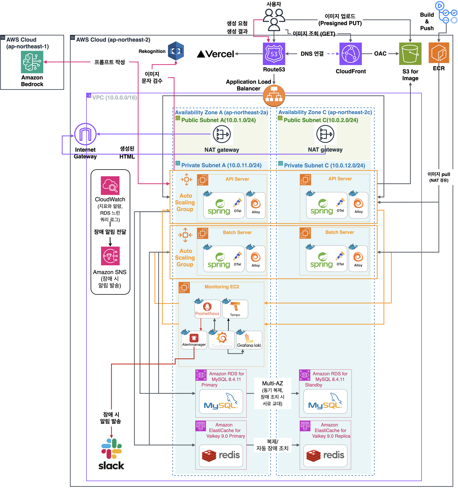
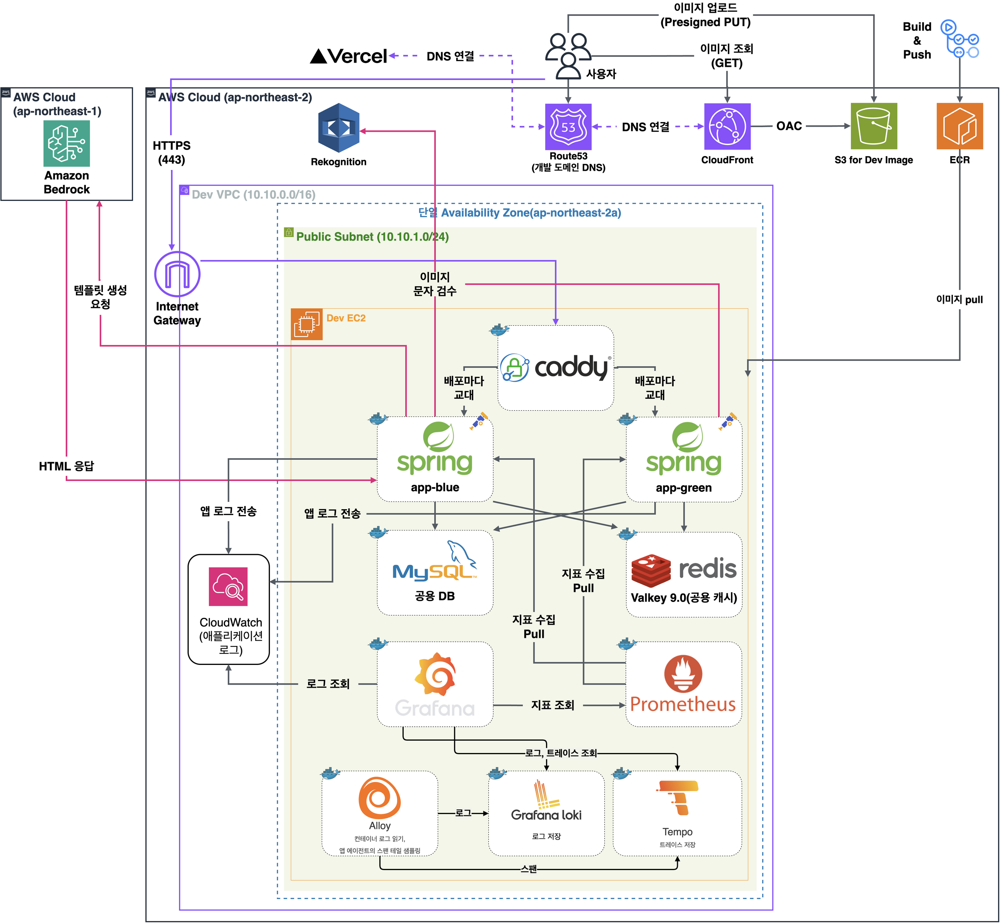
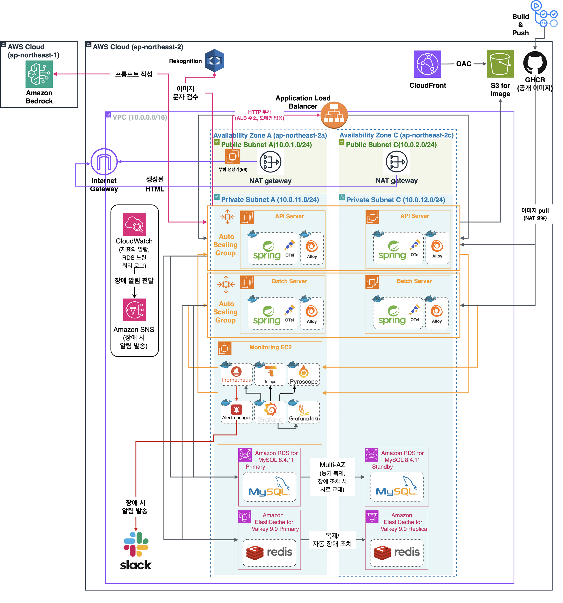

# AWS 아키텍처

실제 AWS 리소스와 이 저장소의 Terraform 에 맞춰 그린 그림이다. 원본은 같은 폴더의 `.drawio` 다.

그림은 구성 요소와 흐름만 그린다. 서버, DB, 캐시의 크기는 그림에 적지 않고 아래 표가 갖는다. 크기는 자주 바뀌는데 그림은 draw.io 로 다시 내보내야 해서, 그림에 적으면 그림이 먼저 낡는다.

## 운영

| 구역 | 구성 |
|---|---|
| 네트워크 | VPC 10.0.0.0/16, AZ 2a, 2c. 퍼블릭 10.0.1.0/24, 10.0.2.0/24 에 NAT Gateway 를 AZ 마다 1대 둔다. 프라이빗 10.0.11.0/24, 10.0.12.0/24 |
| 진입 | Route53 -> ALB -> API 서버. 프론트는 Vercel, 이미지는 CloudFront -> S3 (OAC) |
| 앱 | API 서버, 배치 서버 t3.small 을 AZ 마다 1대씩 각각 Auto Scaling Group 으로 둔다. 이미지는 GitHub Actions 가 ECR 에 올리고 서버가 NAT 를 거쳐 받는다 |
| 데이터 | RDS MySQL 8.4 db.t4g.small Multi-AZ (2026-10-26 06:00 에 micro 에서 올렸다. Primary, Standby 는 장애 조치 때 서로 바뀐다), ElastiCache Valkey 9.0 Primary 2a, Replica 2c |
| 외부 서비스 | Bedrock (ap-northeast-1) 로 템플릿을 만들고 Rekognition 으로 포스터 이미지 문자를 검수한다 |
| 관측 | 모니터링 EC2 (t4g.small) 에서 Grafana, Prometheus, Loki, Tempo, Alertmanager 가 돈다. OpenTelemetry 에이전트는 앱 컨테이너 안의 JVM 에 붙는다. API 서버와 배치 서버마다 Alloy 가 별도 컨테이너로 돌아 컨테이너 로그를 Loki 로 밀고, 에이전트가 낸 스팬을 테일 샘플링해 Tempo 로 보낸다. Alertmanager -> Slack. CloudWatch 알람 -> SNS 메일 |

## 개발

| 구역 | 구성 |
|---|---|
| 네트워크 | Dev VPC 10.10.0.0/16, 단일 AZ 2a, 퍼블릭 서브넷 10.10.1.0/24 |
| 서버 | Dev EC2 (t3.large) 한 대에서 caddy, app-blue, app-green, MySQL, Valkey, Grafana, Prometheus, Loki, Tempo, Alloy 컨테이너가 돈다 |
| 배포 | 배포마다 쉬고 있는 쪽(blue 또는 green)을 띄우고 caddy 가 그쪽으로 넘긴다. 이미지는 ECR (`lunchcatch-dev`) 에서 받는다 |
| 로그 | 앱 로그는 CloudWatch Logs `/lunchcatch/dev/app` (30일) |

## 부하 시험 환경

운영과 같은 모듈을 `envs/lt` 로 불러 띄운다. 서버, DB, 캐시의 크기와 대수는 운영과 같다. 운영과 다른 것만 적는다. 나머지 차이는 [런치캐치_팀원_부하시험환경.md](../system-design/런치캐치_팀원_부하시험환경.md) 1장이 갖는다.

| 구역 | 운영과 다른 것 |
|---|---|
| 진입 | 도메인과 HTTPS 가 없다. 퍼블릭 서브넷 A 의 부하 생성기(m7i-flex.large, k6)가 ALB 주소를 HTTP 로 부른다. Route53 과 Vercel 이 없다 |
| 앱 이미지 | ECR 이 아니라 GHCR 공개 패키지에서 받는다 |
| 관측 | 모니터링 EC2 에 Pyroscope 가 더 뜬다. 추적 에이전트는 늘 붙이지 않고 측정 회차부터 lc-backend 의 `run.sh switch --tracing` 으로 붙인다. 진단 회차에만 부하 시험 도구가 앱 컨테이너에 async-profiler 를 붙여 뜨고 Pyroscope 로 보낸다 |

## 고치는 법

1. `.drawio` 를 draw.io 에서 연다.
2. 고친 뒤 PNG 로 내보낸다. 내보내기 창의 Border Width 를 50 정도로 두어 가장자리에 여백을 준다.
3. `.drawio` 와 `.png` 를 함께 커밋한다. 둘이 어긋나면 그림이 실제와 다른지 원본이 다른지 알 수 없다.

서버, DB, 캐시의 크기를 바꾸는 PR 은 위의 표를 고친다. 그림은 고치지 않는다.
구성 요소나 흐름(서브넷, 리소스, 신호의 길)을 바꾸는 PR 은 그림도 함께 고친다.
