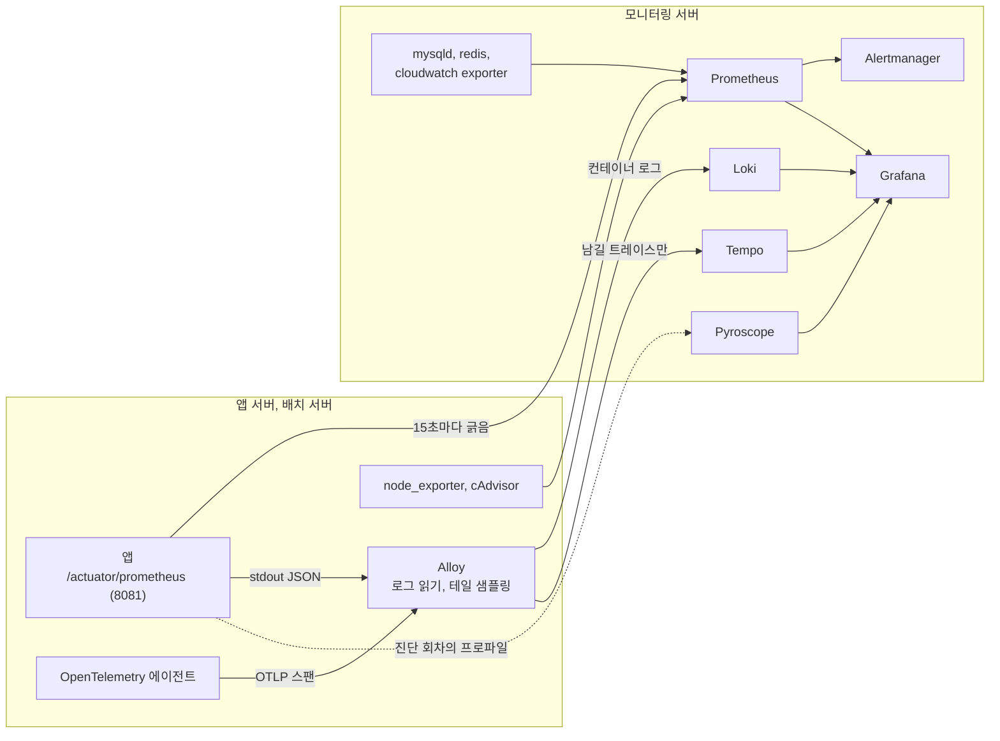

# 모니터링 설계 (백엔드 공통)

관련 문서: [백엔드공통_알람과알림_설계.md](./백엔드공통_알람과알림_설계.md), [백엔드공통_시스템디자인_종합.md](./백엔드공통_시스템디자인_종합.md), [런치캐치_개발서버.md](./런치캐치_개발서버.md), [런치캐치_팀원_부하시험환경.md](./런치캐치_팀원_부하시험환경.md)

---

## 1. 문서 목적

앱과 서버가 낸 신호(지표, 로그, 트레이스, 프로파일)를 받아 어디에 모으고, 얼마 동안 남기고, 어떤 대시보드로 보여 주는지 정한다.

| 내용 | 갖는 곳 |
|---|---|
| 신호를 모으고 보여 주는 구조(이 문서) | `docs/system-design/백엔드공통_모니터링_설계.md` |
| 앱이 내보내는 지표의 이름과 꼬리표, 기준 초과의 기준값 | lc-backend 의 `docs/observability/지표_설계.md` |
| 앱이 남기는 로그의 장치와 모양 | lc-backend 의 `docs/observability/로그_설계.md` |
| 트레이싱의 대상, 표본, 읽는 법 | lc-backend 의 `docs/observability/트레이싱_설계.md` |
| 프로파일링의 방식, 읽는 법 | lc-backend 의 `docs/observability/프로파일링_설계.md` |
| 경보의 경로, 채널, 정의 | [백엔드공통_알람과알림_설계.md](./백엔드공통_알람과알림_설계.md) |
| 경보마다의 대응 | [docs/runbook/경보_대응.md](../runbook/경보_대응.md) |
| 관측 스택의 포트, 접속, 대시보드 반영 | [observability/README.md](../../observability/README.md) |
| 도메인이 지표, 로그, 대시보드, 경보를 더하는 순서 | [docs/wiki/팀원-도메인-모니터링.md](../wiki/팀원-도메인-모니터링.md) |

---

## 2. 수집 구조

| 신호 | 나오는 곳 | 거치는 곳 | 쌓이는 곳 | 근거 |
|---|---|---|---|---|
| 지표 | 앱과 배치의 액추에이터, node_exporter, cAdvisor, mysqld, redis, cloudwatch exporter | 없음. Prometheus 가 긁는다 | Prometheus | `observability/prometheus/prometheus.yml` |
| 로그 | 컨테이너의 표준 출력 | 서버마다 도는 Alloy | Loki | `observability/alloy/config.alloy` |
| 트레이스 | 앱과 배치에 붙인 OpenTelemetry 에이전트 | 서버마다 도는 Alloy 의 테일 샘플링 | Tempo | `observability/alloy/tracing.alloy` |
| 프로파일 | 진단 회차의 앱과 배치 | 없음. 앱이 Pyroscope 로 보낸다 | Pyroscope | lc-backend 의 `loadtest/lib/common.sh` |

### 2.1 지표

모든 대상을 15초마다 긁는다. 페일오버 2분이나 인스턴스 전환 30초 같은 짧은 사건을 보려면 이 해상도가 필요하다.
CloudWatch 지표는 그 자체가 60초 해상도라 60초마다 긁는다. 15초로 긁으면 같은 값을 네 번 받으면서 API 요청만 네 배가 되어 무료 한도를 넘는다.

앱과 배치는 오토 스케일링 그룹이 교체해 주소가 바뀐다. 그래서 EC2 서비스 디스커버리로 `Role` 태그를 보고 찾는다.
`instance` 는 EC2 의 `Name` 태그이고, 서버를 하나씩 가르는 값은 `instance_id` 로 따로 붙인다. 배치는 두 대라 어느 서버가 일을 잡았는지 가를 때 `instance_id` 를 쓴다.
부하로 CPU 가 바닥나면 지표 응답이 10초를 넘어, 앱과 배치의 긁기 시간 제한은 수집 간격과 같은 15초로 둔다.

Grafana 의 Prometheus 데이터 소스는 `timeInterval` 을 15초로 둔다. 패널의 `$__rate_interval` 이 그 4배인 1분부터 시작한다.

### 2.2 로그

서버마다 도는 Alloy 가 도커 소켓에서 컨테이너 로그를 읽어 모니터링 서버의 Loki 로 민다. 로그의 모양은 lc-backend 의 `로그_설계.md` 가 갖는다.

| 레이블 | 값 | 까닭 |
|---|---|---|
| `container` | 컨테이너 이름 | 앱, 배치, 관측 도구의 로그를 가른다 |
| `job` | `docker` | |
| `role` | 서버 역할(`INSTANCE_ROLE`) | 앱 서버와 배치 서버를 가른다 |
| `git_sha` | 배포한 커밋 | 롤링 배포의 혼재 구간에서 구 버전과 신 버전을 가른다. 배포마다 하나씩 늘어 값의 종류가 유한하다 |

인스턴스 ID 는 레이블로 쓰지 않는다. 오토 스케일링 그룹이 교체할 때마다 새 값이 생겨 레이블 값이 끝없이 늘고, Loki 가 느려진다.

### 2.3 트레이스

에이전트가 낸 스팬은 같은 서버의 Alloy 가 받는다. Alloy 는 요청 하나의 스팬이 모두 모일 때까지 기다린 뒤, 정책 가운데 하나라도 맞는 트레이스만 Tempo 로 보낸다.
정책은 오류, 기준을 넘은 요청, 백그라운드 작업 등이다. 어떤 트레이스를 얼마나 남기는지와 그 까닭은 lc-backend 의 `트레이싱_설계.md` 4장이 갖는다. 이 절은 Alloy 가 그 결정을 어떻게 구현하는지 적는다.

| 남길 대상 | Alloy 가 가르는 방법 |
|---|---|
| 오류 | 상태가 `ERROR` 인 스팬이 있는 트레이스 |
| 기준을 넘은 HTTP 요청 | 트레이스 안의 스팬 가운데 하나라도 `http.route` 와 메서드가 그 API 와 맞고, 트레이스의 시간이 그 API 의 기준을 넘은 것. 같은 경로에 메서드마다 기준이 달라 메서드와 경로를 함께 보는 OTTL 조건(스팬마다 따지는 조건)으로 고른다. 트레이스의 시간은 맨 위 스팬의 시간이 아니라 가장 이른 스팬의 시작부터 가장 늦은 스팬의 끝까지다(`latency` 정책) |
| 앱 서버의 백그라운드 작업 | 서비스 이름이 `lunchcatch` 이고, `http.route` 가 붙은 스팬이 없고, 기동 때 `main` 스레드의 트레이스가 아닌 것(워커) |
| 배치 서버의 백그라운드 작업 | 서비스 이름이 `lunchcatch-batch` 이고, `http.route` 가 붙은 스팬(헬스체크, 지표 수집)이 없고, 기동 때 `main` 스레드의 트레이스(Flyway 와 MySQL 드라이버의 쿼리)가 아닌 것. 서비스 이름은 모든 스팬에 붙어 있어, 루트 스팬이 판정 대기 뒤에 오더라도 대기 동안 모인 스팬으로 가를 수 있다 |

백그라운드 정책이 뺀 트레이스도 다른 정책(오류 등)에 맞으면 남는다. 정책 가운데 하나라도 맞으면 남기기 때문이다.

느린 요청을 고르는 기준은 lc-backend `application.yml` 의 `lunchcatch.observability.targets.api` 와 같은 값을 옮겨 적는다. Alloy 는 앱 설정을 읽지 못해서다. 그 값을 바꾸면 `tracing.alloy` 도 함께 고친다.

**판정 대기와 결정 캐시.** Alloy 는 트레이스의 첫 스팬이 온 때부터 `decision_wait` 동안 기다린 뒤, 그때까지 모인 스팬으로 정책을 따진다. 판정 뒤 늦게 온 스팬은 결정 캐시(`decision_cache`)가 그 트레이스에 앞서 내린 결정을 따르게 한다. 몇 분 걸리는 cron 실행은 맨 위 스팬이 작업이 끝날 때 와서 판정 대기를 넘기는데, 결정 캐시 덕에 남기기로 한 트레이스의 루트를 버리지 않는다.

| 수치 | 값 | 산정 근거 | 참고 자료 |
|---|---|---|---|
| 판정 대기 | 10초 | 트레이스를 메모리에 짧게 들고 있어 판정 버퍼에 쌓이는 수가 적고 Alloy 메모리가 덜 든다. HTTP 요청은 대개 1초 안에 끝나 10초면 스팬이 다 모인다. 늦게 오는 스팬은 결정 캐시가 앞선 결정을 따르게 한다. Alloy 의 기본값은 30초다 | [otelcol.processor.tail_sampling](https://grafana.com/docs/alloy/latest/reference/components/otelcol/otelcol.processor.tail_sampling/) |

Tempo 는 스팬 이름마다의 호출 수와 지연(span-metrics), 서비스 사이의 관계(service-graphs)를 지표로 만들어 Prometheus 로 보낸다.

### 2.4 프로파일

프로파일은 부하 시험 환경의 진단 회차에서만 뜬다. 앱이 묶음마다 Pyroscope 로 보내고, 진단 회차가 끝나면 파일로 남긴다. 무엇을 어떻게 뜨는지는 lc-backend 의 `프로파일링_설계.md` 2장이 갖는다.

---

## 3. 보관 기간

| 신호 | 기간 | 설정 | 까닭 |
|---|---|---|---|
| 지표 | 30일 | Prometheus `--storage.tsdb.retention.time=30d` | 추세를 견주는 기간이다. 품질 문서의 보존 기간과 같다 |
| 로그 | 30일 | Loki `retention_period: 720h` 와 compactor 의 `retention_enabled` | 지표와 같은 기간이다. 기간이 없으면 지우지 않아 모니터링 서버의 디스크(20 GB)가 차면 멈춘다. compactor 를 켜지 않으면 기간을 두어도 지우지 않는다 |
| 트레이스 | 72시간 | Tempo `block_retention: 72h` | 부하 시험 환경은 시험이 끝나면 지운다. 사흘이면 회차를 되짚기에 넉넉하다 |
| 프로파일 | 이미지의 기본값 | 설정하지 않는다 | 진단 회차가 끝나면 파일로 남겨, 환경을 내린 뒤에는 다시 보기로 올린다 |

환경을 내리면 그 환경의 지표, 로그, 트레이스, 프로파일이 함께 사라진다. 부하 시험의 회차는 캡처가 파일로 남기고, 다시 보기(7장)로 다시 띄운다.

---

## 4. 대시보드 구조

대시보드는 계층마다 폴더로 나눈다. 폴더와 대시보드는 계층 순서로 놓는다. Grafana 는 이름순으로만 놓아 폴더 이름과 대시보드 제목 앞에 순번을 붙인다. 대시보드가 하나뿐인 폴더는 붙이지 않는다.
`시스템 개요` 는 Grafana 를 열면 먼저 뜨는 홈 대시보드다.

| 폴더 | 답하는 질문 | 대시보드 |
|---|---|---|
| 1. 개요 | 지금 어디가 이상한가 | 시스템 개요 |
| 2. 서비스 | 사용자가 받는 응답과 뒤에서 처리하는 일이 기준 안에 있는가 | 1. SLI, 2. API, 3. 백그라운드 작업 |
| 3. 도메인 | 도메인만의 업무 결과와 실패가 정상인가 | 1. 광고 서빙, 2. 정산, 3. 분석 |
| 4. 런타임 | 앱 프로세스의 스레드, 커넥션 풀, CPU, 메모리, GC 가 버티는가 | 애플리케이션 서버 자원 |
| 5. 의존 시스템 | 앱이 기대는 RDB, 인메모리 DB, 외부 연동이 느리거나 실패하는가 | 1. RDB, 2. 인메모리 DB, 3. 외부 연동 |
| 6. 인프라 | 호스트와 모니터링 자신이 정상인가 | 1. 호스트, 2. 모니터링 상태 |
| 7. 테스트 | 부하 생성기가 목표 부하를 다 보냈는가 | 부하 시험 |

대시보드는 파일(`observability/grafana/dashboards/`)로만 둔다. 데이터 소스도 손으로 등록하지 않고 고정한 `uid` 로 공급한다. 인스턴스를 다시 만들어도 대시보드가 같은 데이터 소스를 찾아야 해서다.

`2. 서비스` 와 `4. 런타임` 은 모든 도메인이 쓰는 공통 지표만 그린다. 도메인만의 값은 그 도메인 대시보드에 둔다.

---

## 5. 내려가 보는 순서

원인은 넓은 화면에서 좁은 화면으로 내려가며 좁힌다.

| 단계 | 화면 | 보는 것 | 다음으로 가는 길 |
|---|---|---|---|
| 1 | 시스템 개요 | 영역(API, 릴레이, 워커, cron, JVM, DB 커넥션, 인메모리 DB, 외부 연동)마다 기준을 넘었는지, 울리는 경보 | 영역의 패널을 누르면 그 영역의 대시보드가 같은 시간 범위로 열린다 |
| 2 | API, 백그라운드 작업, 애플리케이션 서버 자원, 의존 시스템 | 기준을 넘은 이름과 그 구간 | 튄 곳을 드래그해 구간을 좁히고 선의 점을 누르면 그 구간의 트레이스 검색(Tempo)이 열린다 |
| 3 | 트레이스 | 오래 걸린 단계 | 트레이스에서 그 시각의 로그(Loki)와 프로파일(Pyroscope)로 넘어간다 |
| 4 | 로그, 프로파일 | 그 실행의 경고와 오류, 시간을 쓴 코드 | 로그의 `trace_id` 를 누르면 다시 그 트레이스로 돌아간다 |

신호 사이의 링크는 Grafana 의 데이터 소스 설정(`observability/grafana/provisioning/datasources/datasources.yml`)이 만든다.

| 출발 | 도착 | 설정 |
|---|---|---|
| 트레이스 | 로그 | Tempo 의 `tracesToLogsV2`. 스팬 앞뒤 1분의 앱 컨테이너 로그에서 그 트레이스 ID 를 찾는다 |
| 트레이스 | 프로파일 | Tempo 의 `tracesToProfiles`. wall 프로파일을 연다 |
| 로그 | 트레이스 | Loki 의 `derivedFields`. JSON 로그의 `trace_id` 를 Tempo 링크로 만든다 |

Tempo 가 없는 환경에서는 로그에서 트레이스로 가는 링크만 깨진다. Pyroscope 가 없는 환경에서 Pyroscope 데이터 소스를 고르면 연결 오류가 난다.
트레이스를 읽는 법은 lc-backend 의 `트레이싱_설계.md` 7장이, 프로파일을 읽는 법은 `프로파일링_설계.md` 5장이 갖는다.

---

## 6. 기준 초과 판정

판정 패널은 처리 시간이 기준을 넘은 이름(API, 릴레이, 워커, cron 작업)만 그린다. 기준은 이름마다 다르다. 그래서 기준을 시계열 `overrun_threshold_seconds{kind, name}` 로 두고, 쿼리가 측정값과 기준을 이름끼리 맞대어 넘은 것만 남긴다.

| 기준의 종류 | 내는 곳 | 값의 원본 |
|---|---|---|
| `api`, `relay`, `worker`, `job` | 앱이 게이지로 낸다 | lc-backend 의 `지표_설계.md` 6장 |
| `global` (GC 멈춤, 트랜잭션 시간) | Prometheus 기록 규칙 `observability/prometheus/thresholds.yml` | 품질 문서의 `[인프라]` 항목 |

작업을 정의한 코드와 그 기준을 같은 저장소에서 함께 고치려고, 작업마다의 기준은 앱 설정이 갖는다. 이 저장소에는 품질 문서의 `[인프라]` 항목 값과 인프라 담당이 경보에 쓰는 배치 작업의 임계값만 둔다.
시간이 아닌 비율(GC 직후 힙 사용률, GC 로 멈춘 시간의 비율)은 `overrun_threshold_ratio` 로 이름을 나눈다.

기준을 쓰는 대시보드는 아래와 같다.

| 대시보드 | 판정하는 것 |
|---|---|
| 시스템 개요 | 영역(API, 릴레이, 워커, cron, JVM)마다 기준을 넘은 이름의 수, 전체 API 응답 시간 |
| 2. API | 기준을 넘은 API, 느린 엔드포인트 상위 10개, API 별 p99 |
| 3. 백그라운드 작업 | 릴레이의 발행 지연 p99, 워커의 가장 오래 기다린 일, cron 작업의 실행 시간과 시작 뒤 지난 시간 |
| 애플리케이션 서버 자원 | 트랜잭션 시간, GC 멈춤, GC 뒤에 남은 힙 |
| 부하 시험 | k6 가 본 응답 지연 |

API, 백그라운드 작업 대시보드의 판정 패널은 선의 점에서 그 구간의 트레이스 검색으로 넘어간다(5장).
SLI 대시보드는 판정 패널과 따로, 앱의 목표 안 카운터(`http.server.requests.target`)로 API 마다의 성공 비율과 목표 안 비율을 기록 규칙(`observability/prometheus/sli.yml`)으로 그린다.

---

## 7. 환경별 차이

| 환경 | 지표 | 로그 | 트레이스 | 프로파일 | 경보 |
|---|---|---|---|---|---|
| 운영 | 켬 | 켬 | 켬. 에이전트를 늘 붙인다 | 끔 | 켬 |
| 부하 시험 환경 | 켬 | 켬 | 켬. 에이전트는 측정마다 lc-backend 의 `run.sh switch --tracing <버전>` 으로 붙인다 | 켬. 진단 회차에서만 뜬다 | 켬. 제목에 환경을 붙여 운영 경보와 가른다 |
| 개발 서버 | 켬 | 켬. CloudWatch Logs 에도 30일 남긴다 | 켬 | 끔 | 없음. 모니터링 서버를 따로 두지 않는다 |
| 로컬 | 켬 | 켬 | Tempo 가 늘 뜬다. 에이전트는 lc-backend 의 `run.sh --local switch --tracing <버전>` 으로 붙인다 | Pyroscope 가 늘 뜬다. 진단 회차에서만 보낸다 | 규칙만 같다. Alertmanager 가 없어 알림이 나가지 않는다 |
| 다시 보기 | 남긴 파일을 넣는다 | 남긴 파일을 넣는다 | 남긴 파일을 넣는다 | 남긴 파일을 넣는다 | 없음 |

| 환경 | 켜고 끄는 곳 |
|---|---|
| 운영, 부하 시험 환경 | `modules/compute` 의 `tracing_enabled`, `tracing_agent_enabled`, `profiling_enabled`. `envs/prod` 와 `envs/lt` 가 값을 준다. `refresh-monitoring-env` 가 그 값으로 모니터링 서버의 compose 프로필(`tracing`, `profiling`)을 정한다 |
| 개발 서버 | `dev/` 의 구성. [런치캐치_개발서버.md](./런치캐치_개발서버.md) |
| 로컬 | `observability/local/compose.yaml`. 부하 시험 환경을 닮게 앱과 배치를 나누려면 `compose.lt-like.yaml` 을 함께 붙인다 |
| 다시 보기 | `observability/local/compose.replay.yaml` 을 붙여 `scripts/loadtest-replay.sh` 가 띄운다. 지난 시각의 신호를 지우거나 거절하지 않게만 바꾼다 |

로컬은 운영과 같은 대시보드, 기준 규칙, 경보 규칙 파일을 쓴다. 그래서 대시보드와 규칙을 바꾸면 로컬에서 먼저 확인한다.

---

## 8. 모니터링이 멈췄을 때

모니터링 서버는 한 대라 단일 장애점이다. 이 서버가 죽으면 감지 수단이 함께 사라진다. 그래서 두 가지를 더 둔다.

| 수단 | 하는 일 |
|---|---|
| CloudWatch 알람 | 모니터링 서버가 죽어도 알아야 하는 핵심 항목만 이중으로 둔다 |
| Watchdog | 늘 울리는 경보다. 이 경보가 오지 않으면 알림 경로가 끊긴 것이다 |

모니터링 자신의 상태는 `6. 인프라` 의 `2. 모니터링 상태` 대시보드가 보인다. 앱과 배치의 지표 수집 시간과 실패, 구성 요소가 살아 있는지, 규칙 평가 실패, 판정 전에 버리거나 거절한 스팬을 그린다.
경보의 정의와 이중화의 기준은 [백엔드공통_알람과알림_설계.md](./백엔드공통_알람과알림_설계.md) 2장과 4.3절이 갖는다.

---

## 9. 정할 것

| 항목 | 정하는 데 필요한 것 |
|---|---|
| 대시보드와 경보의 비어 있는 임계값 | [observability/README.md](../../observability/README.md) 의 "아직 채우지 못한 임계값" 이 갖는다 |
| SLI 의 목표(SLO) | SLI 대시보드는 목표를 정하지 않아 색과 선이 없다. 목표를 정하면 그 대시보드와 기록 규칙에 넣는다 |
| 외부 연동의 기준 | 외부 연동 대시보드는 기준을 정하지 않았다 |
