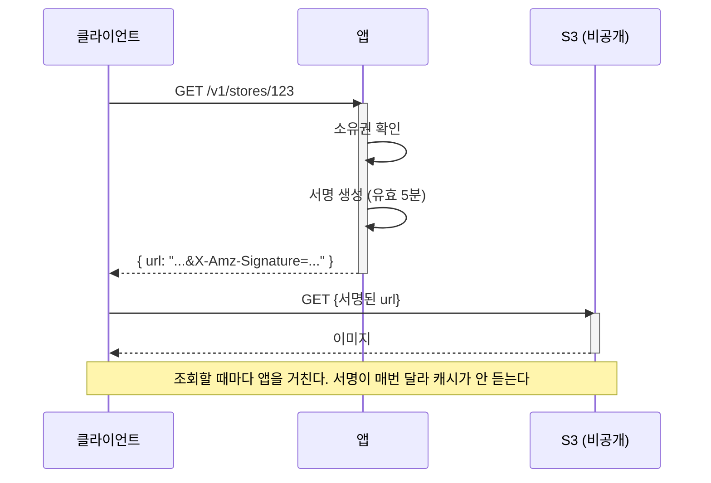
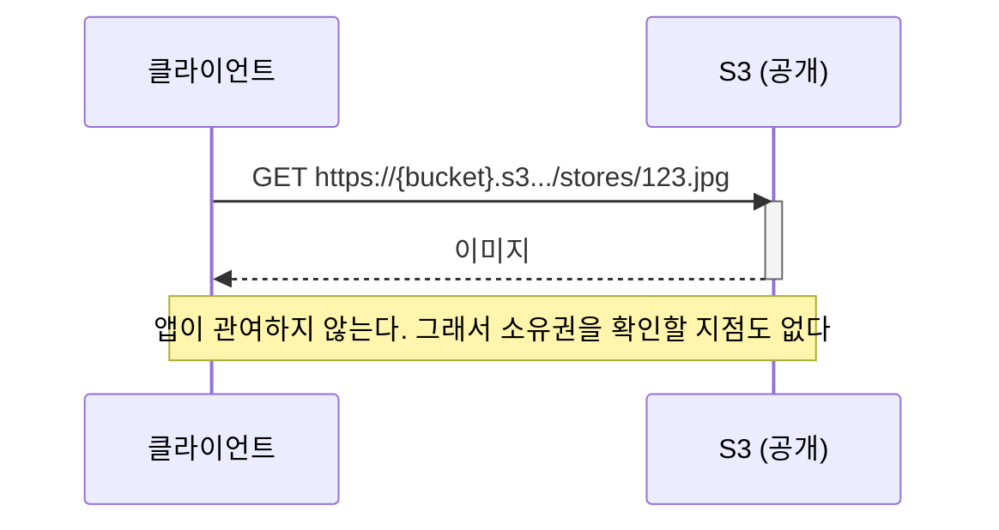
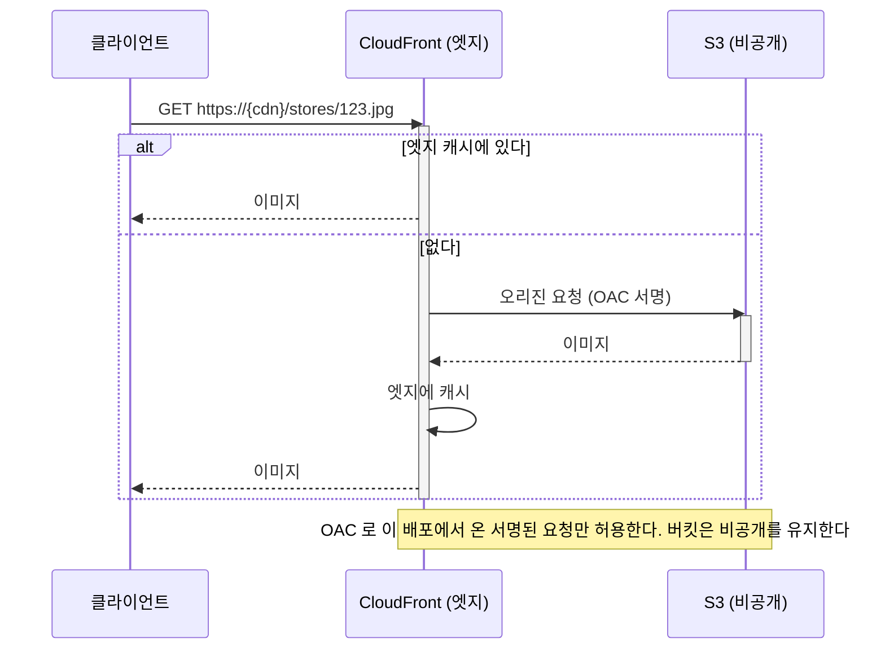
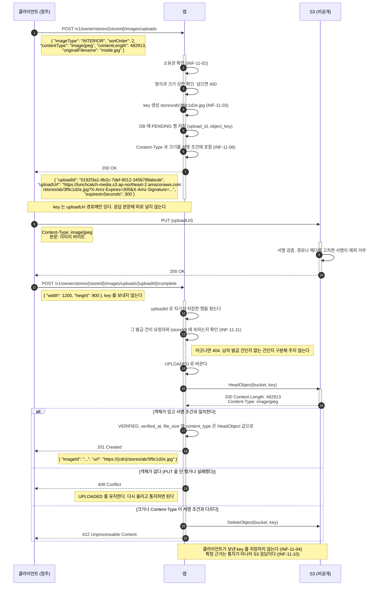
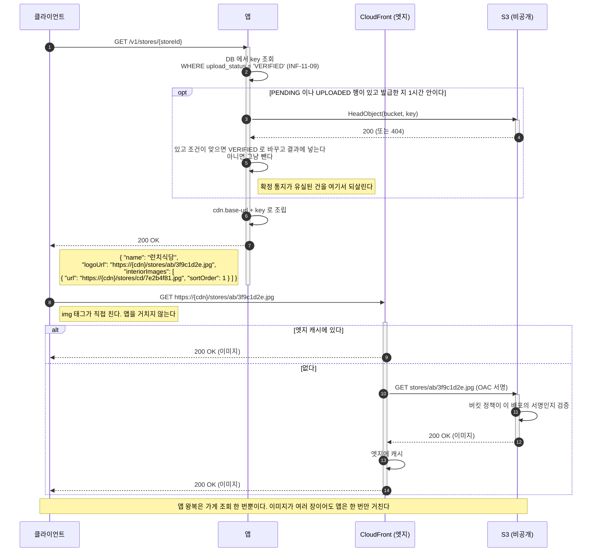
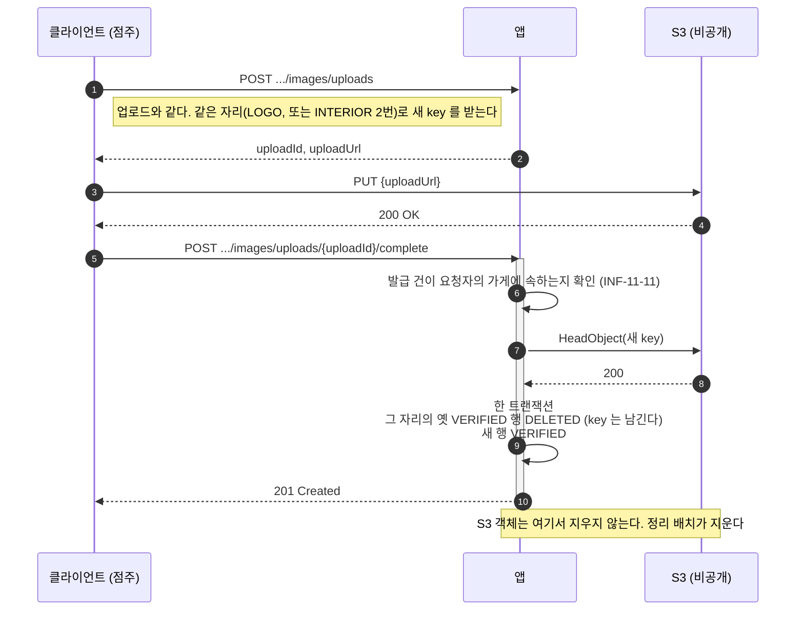
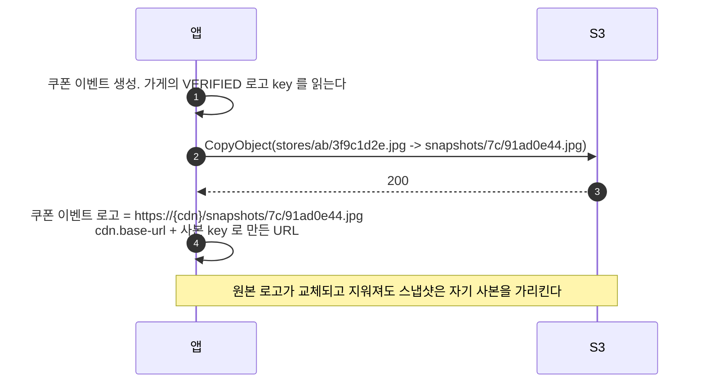
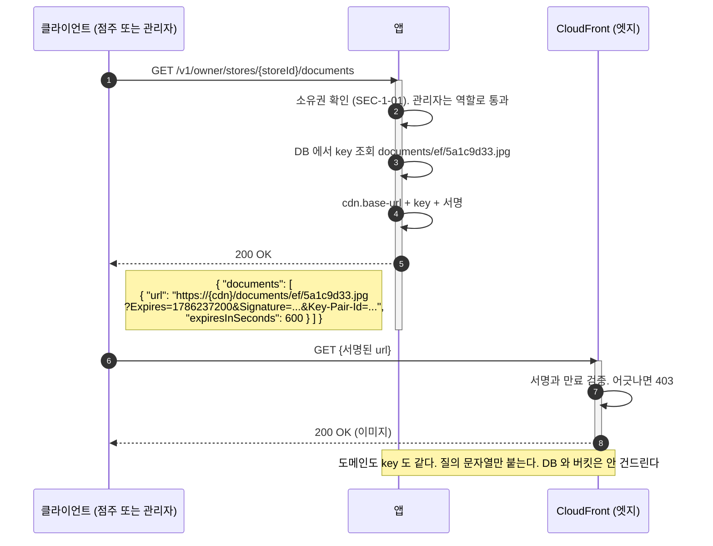

# 이미지 저장소: 설계 근거와 선택지 비교 (백엔드 공통)

작성 기준일: 2026-08-08 (런치캐치 기준 개정 2026-10-12)
적용 대상: 런치캐치의 가게 이미지(로고, 인테리어), 대표 메뉴 이미지, 포스터 메뉴 이미지
관련 문서: [백엔드공통_기술스택_확정문서.md](./백엔드공통_기술스택_확정문서.md), [백엔드공통_시스템디자인_종합.md](./백엔드공통_시스템디자인_종합.md)

**확정: CloudFront + OAC (3.3절)** 2026-08-08

이 문서는 그 결정의 근거로 남는다. 세 선택지를 비교한 내용은 그대로 둔다.
확정값은 기술 스택 확정 문서 2.6절과 5.2절에, 점검 항목은 `docs/infra-review/code-guideline.md` 11장에 있다.

**2026-10-12 개정.** 처음에는 신선식품 자사몰(상품 이미지, 클레임 사진) 기준으로 썼다. 런치캐치 백엔드가 이미 스키마를 정했으므로
**어긋나는 곳은 스키마를 따른다.** 바뀐 결정은 0절에 모았다.

---

## 0. 런치캐치 기준으로 바뀐 것

| 항목 | 처음 결정 | 지금 (lc-backend develop 스키마) |
|---|---|---|
| 대상 | `product_image`, `claim_attachment`, `shipment_photo` | `store_image`, `store_menu_image`, `poster.image_object_key` |
| 상태값 | `PENDING`, `CONFIRMED` | `PENDING`, `UPLOADED`, `VERIFIED` + `verified_at` |
| 메타데이터 | 크기와 형식을 저장하지 않는다 | `content_type`, `file_size`, `width`, `height`, `original_filename` 을 저장한다 (6.2절) |
| 형식, 크기 | 1 ~ 2 MB | DB 상한 10 MB, `image/jpeg` 와 `image/png` 만 (CHECK) |
| 대표, 순서 | `is_main` 과 유일하지 않은 `sort_order` | 로고는 가게당 하나, 인테리어는 1 ~ 3 번 자리. 둘 다 DB 가 유일성을 강제한다 |
| 비공개 이미지 | 클레임 증빙, 배송 사진 | **없다.** 사업자 검증은 번호만 받는다 (`store.business_registration_number`) |
| 스냅샷 | 없었다 | `coupon_event`, `ad_candidate` 가 가게 로고를 URL 로 복사해 둔다 (6.2절 "스냅샷") |

**스키마가 아직 못 따라온 것**도 있다. 교체와 삭제(6.2절)를 하려면 백엔드가 고쳐야 한다. 목록은 6.4절이다.

## 1. 이미 정해진 것

| 항목 | 값 | 근거 |
|------|-----|------|
| 저장소 | S3 (ap-northeast-2), 버킷 `lunchcatch-media` | 같은 리전에서 Terraform 상태도 S3 에 둔다 |
| 업로드 경로 | **presigned URL 로 클라이언트가 직접** | 앱 대역폭과 메모리를 쓰지 않는다 |
| 이미지 가공 | **없음. 원본만 저장** | 리사이징은 추가 인프라나 CPU 를 요구한다 |

업로드를 앱이 중계하지 않는 이유는 앱 서버가 버스트 인스턴스이기 때문이다.
멀티파트 업로드를 앱이 받으면 톰캣 스레드가 파일 전송 시간만큼 잡히고, 요청 본문 크기 상한(`SEC-3-05`)도 함께 올려야 한다.

**남은 것은 "내려줄 때 어떻게 하는가" 하나다.**

## 2. 전제 조건

이 인프라의 확정 사항 중 판단에 영향을 주는 것들이다.

| 조건 | 값 | 영향 |
|------|-----|------|
| 앱 위치 | **사설 서브넷** | S3 는 게이트웨이 엔드포인트로 직행하므로 NAT 요금을 안 탄다 |
| NAT Gateway | 2대 (AZ 당 하나) | 2026-09-23 에 결정했다 (INF-09). 보안 그룹 단일 방어선의 한계 |
| 월 예산 | 140 USD (`terraform/variables.tf` `monthly_budget_usd`) | 이미지 저장소가 큰 비중을 차지하면 안 된다 |
| 앱 서버 | ASG 2 ~ 3대, 버스트 인스턴스 | 버스트 크레딧에 의존한다. CPU 를 쓰는 선택은 불리하다 |

## 3. 선택지

### 3.1 presigned URL (비공개 버킷)



버킷은 완전 비공개다. 서명 없이는 아무도 못 읽는다.

**장점**

* `SEC-1-01`(리소스 접근 시 소유권 검증), `SEC-1-03`(목록 조회에도 소유자 조건)을 **앱이 완전히 통제**한다
* 버킷 공개 설정 자체가 없어 실수로 다른 파일이 노출될 여지가 없다
* 서명 만료로 링크 유출의 수명을 제한할 수 있다

**단점**

* **캐시가 안 된다.** URL 에 서명이 붙어 매번 달라지므로 브라우저도 CDN 도 재사용하지 못한다
* 조회할 때마다 앱을 거친다. 피드 한 화면에 가게 로고가 20장이면 서명 발급 20회다
* 같은 이미지를 100명이 보면 S3 에서 100번 전송된다. 전송비가 조회 수에 비례한다

**적합한 곳**: 본인과 관리자만 봐야 하는 서류

### 3.2 퍼블릭 읽기 버킷



**장점**

* 가장 단순하다. 앱 부하가 0 이고 구성할 것이 버킷 정책 하나뿐이다
* URL 이 고정이라 브라우저 캐시가 그대로 듣는다
* 실패 지점이 적다

**단점**

* **소유권 검증이 원천적으로 불가능하다.** URL 을 아는 사람은 누구나 본다
* 버킷을 공개로 열어 두므로, 나중에 비공개 파일을 같은 버킷에 올리면 함께 노출된다
* 전송비는 조회 수에 비례한다. CDN 이 없어 엣지 캐시 이득이 없다

**적합한 곳**: 가게 로고, 메뉴 사진, 배너

### 3.3 CloudFront + OAC



**장점**

* 버킷이 비공개다. S3 URL 로 직접 접근하면 거부된다
* **엣지 캐시가 듣는다.** 같은 이미지의 두 번째 조회부터는 S3 를 안 거친다
* CloudFront 에는 상시 무료 구간이 있어(월 1TB 전송, 1000만 요청) 이 규모에서는 S3 직접 전송보다 쌀 가능성이 높다
* 나중에 서명된 쿠키나 URL 로 접근 제어를 얹을 수 있다. **구조를 안 바꿔도 된다**

**단점**

* 배포 하나가 추가된다. Terraform 구성, OAC, 버킷 정책이 늘어난다
* **무효화 정책이 생긴다.** 이미지를 교체했는데 엣지 캐시가 남는 문제를 다뤄야 한다 (6.2절 "교체와 삭제" 가 새 key 로 풀었다)
* 디버깅 계층이 하나 는다. 안 보이는 이미지의 원인이 S3 인지 CloudFront 인지 갈린다
* 배포 전파에 시간이 걸려 초기 구축과 변경이 즉시 반영되지 않는다

**적합한 곳**: 공개 이미지가 많고 조회가 잦은 경우

## 4. 비용

### 4.1 단가 (등급 C. 서울 단가 미검증)

**아래 값은 확인하지 않았다.** 기술 스택 확정 문서 5.1절이 밝힌 대로 총액의 상당 부분이 추정치이며, 이 표도 같은 상태다.
구축 확정 전에 AWS 요금 계산기로 검증한다.

| 항목 | 추정 단가 | 비고 |
|------|-----------|------|
| S3 Standard 저장 | 약 0.025 USD/GB/월 | |
| S3 GET 요청 | 약 0.0004 USD/1000건 | |
| S3 PUT 요청 | 약 0.005 USD/1000건 | 업로드, 스냅샷 복사 |
| S3 인터넷 전송 | 약 0.126 USD/GB | **비용의 대부분** |
| CloudFront 전송 | 약 0.12 USD/GB | 월 1TB 까지 무료 구간 |
| CloudFront 요청 | 약 0.009 USD/1만건 | 월 1000만건까지 무료 구간 |
| CloudFront 오리진 요청 | 0 USD | S3 와 같은 리전이면 전송비 없음 |

### 4.2 가정한 사용량 (등급 C)

**실측 전이라 전부 가정이다.** 규모가 달라지면 결론이 바뀔 수 있다.

| 항목 | 가정 |
|------|------|
| 가게 수 | 500개 |
| 가게당 이미지 | 로고 1 + 인테리어 3 + 대표 메뉴 3 = 7장 |
| 이미지 크기 | 300KB (원본만 저장하므로 큰 편) |
| 저장 총량 | 약 1GB (쿠폰 이벤트 스냅샷 복사분은 로고라 미미하다) |
| 월 이미지 조회 | 30만건 (피드의 가게 로고 중심) |
| 월 전송량 | 약 90GB |

### 4.3 선택지별 월 비용 (등급 C)

| 항목 | presigned | 퍼블릭 읽기 | CloudFront |
|------|-----------|-------------|------------|
| 저장 (1GB) | 0.03 | 0.03 | 0.03 |
| GET 요청 (30만) | 0.12 | 0.12 | 0.12 (오리진은 캐시 적중분만) |
| 전송 (90GB) | **11.34** | **11.34** | **0** (무료 구간 내) |
| CloudFront 요청 | - | - | 0 (무료 구간 내) |
| **합계** | **약 11.5 USD** | **약 11.5 USD** | **약 0.2 USD** |

**전송비가 전부를 가른다.** 저장과 요청은 어느 쪽이든 소액이다.

CloudFront 가 싼 이유는 무료 구간 때문이며, 월 1TB 를 넘으면 S3 직접 전송과 비슷해진다.
다만 캐시 적중분은 오리진 전송이 발생하지 않으므로, 넘더라도 S3 직접보다 유리하다.

**presigned 는 캐시가 안 되므로 실제 전송량이 더 클 수 있다.** 브라우저 재방문에서도 다시 받는다.

## 5. 비교

| | presigned | 퍼블릭 읽기 | CloudFront + OAC |
|---|---|---|---|
| 버킷 공개 | 비공개 | **공개** | 비공개 |
| 소유권 검증 | **가능** | 불가능 | 조건부 (서명 쿠키 추가 시) |
| 브라우저 캐시 | **안 됨** | 됨 | 됨 |
| CDN 캐시 | 안 됨 | 안 됨 | **됨** |
| 앱 부하 | 조회마다 서명 | 없음 | 없음 |
| 월 비용 (가정 기준) | 약 11.5 USD | 약 11.5 USD | **약 0.2 USD** |
| 구성 복잡도 | 낮음 | **가장 낮음** | 높음 |
| 나중에 접근 제어 추가 | 이미 있음 | **어렵다** | 가능 |

## 6. 판단

### 6.1 URL 이 만들어지는 방식

**DB 에는 key 만 둔다.** URL 은 조회할 때 조립한다.

```
DB    stores/ab/3f9c1d2e.jpg                   <- key. 이것만 저장한다
설정  cdn.base-url: https://{cdn}              <- 프로파일마다 다르다. 앱은 CDN_BASE_URL 로 받는다
      s3.bucket-url: https://lunchcatch-media.s3.ap-northeast-2.amazonaws.com

조회  https://{cdn}/stores/ab/3f9c1d2e.jpg
업로드 https://lunchcatch-media.s3.ap-northeast-2.amazonaws.com/stores/ab/3f9c1d2e.jpg?X-Amz-Signature=...
```

**같은 key 에 도메인만 다르게 붙는다.** 조회는 CloudFront, 업로드는 S3 다.
CloudFront 는 경로를 변환하지 않고 그대로 객체 key 로 오리진에 묻는다. 그래서 도메인만 갈아 끼우면 된다.

#### key 저장과 URL 저장

클라이언트가 받는 것은 양쪽 다 완전한 URL 이다. **조립을 언제 하느냐만 다르다.**

| 쟁점 | 판단 |
|------|------|
| 비공개 버킷 (OAC) | **key / URL 무관.** 어느 쪽이든 버킷은 비공개다 |
| 도메인 교체 | key 가 유리. 설정 한 줄 대 전 행 UPDATE |
| 환경별 도메인 | key 가 유리. 프로파일로 처리한다 |
| **접근 제어 (서명 URL)** | **key 여야 가능** |

**첫 줄을 분명히 해 둔다.** key 저장은 버킷을 비공개로 두기 위한 조건이 아니다.
비공개 버킷은 OAC 설정의 문제이고, 전체 URL 을 저장해도 그것이 CloudFront 주소이면 버킷은 비공개로 남는다.

가운데 둘은 편의 차이다. URL 로 저장해도 되지만 바꿀 때 전 행을 건드린다.

**스냅샷은 예외로 URL 을 둔다** (2026-10-12 결정). `ad_candidate.store_image_url` 과 `coupon_event` 의 로고가 그렇다.
만든 시점의 값을 그대로 내보내는 표시용이라 조회 때 조립하지 않는 쪽을 택했다. 도메인을 바꾸면 그 행들을 다시 써야 하는 것을 받아들였다.
이미지 테이블(`store_image`, `store_menu_image`)과 `poster` 는 key 를 유지한다. 로고 교체와의 관계는 6.2절 "스냅샷" 에 있다.

#### 접근 제어 때문에 key 로 한다

넷 중 **"가능/불가능" 으로 갈리는 것은 마지막 하나뿐이고, 그것이 결정 근거다.**

```
공개 이미지    https://{cdn}/stores/ab/3f9c1d2e.jpg
              고정값이라 저장할 수 있다

비공개 이미지  https://{cdn}/documents/ef/5a1c9d33.jpg
                ?Expires=1786237200&Signature=abc...&Key-Pair-Id=...
              발급할 때마다 서명과 만료가 달라진다. 저장할 수 있는 값이 아니다
```

3.3절이 CloudFront + OAC 를 고른 이유가 **"나중에 서명 URL 로 접근 제어를 얹어도 구조를 안 바꾼다"** 였다.
URL 을 통째로 저장하면 그 시점에 저장 방식부터 갈아엎어야 하므로 **채택 근거가 무효가 된다.**

지금 런치캐치의 이미지는 모두 공개라 당장 못 하게 되는 것은 없다.
다만 사업자 증빙을 파일로 받게 되면 바로 비공개 이미지가 생기고, **되돌리는 비용이 한쪽으로 크게 기운다.**

```
key 로 시작   URL 이 필요해지면 조회 코드 한 줄을 고친다
URL 로 시작   컬럼 이름, 저장된 값, 조회 코드를 함께 고친다. 그때는 데이터가 이미 들어 있다
```

`INF-11-05` 가 이 결정을 점검한다.

**key 는 서버가 만든다.**

```
stores/{두 글자}/{난수}.jpg       가게 로고, 인테리어
menus/{두 글자}/{난수}.jpg        대표 메뉴
snapshots/{두 글자}/{난수}.jpg    스냅샷 복사본 (6.2절 "스냅샷")
```

클라이언트가 준 파일명을 쓰지 않는다. 경로 조작과 덮어쓰기가 가능해지기 때문이다 (`INF-11-03`).
`original_filename` 은 표시용으로만 저장하고 key 에는 쓰지 않는다. 앞 두 글자는 한 프리픽스에 객체가 몰리지 않게 나눈 것이다.

**공개 여부를 경로에 넣지 않는다.** 공개 여부가 운영 중에 바뀔 수 있어, 경로에 넣으면 토글 한 번이 객체 이동과 DB 수정이 된다.

### 6.2 채택안

**CloudFront + OAC 를 택했다.** 버킷은 하나이고 비공개다.

* 버킷을 공개하지 않으면서 캐시를 얻는다
* 비용이 가장 낮다 (가정 기준)
* 비공개 이미지가 생겨도 저장 구조와 key 를 그대로 둔 채 URL 발급만 바꾼다

구성이 늘어나는 것이 유일한 대가이며, Terraform 을 어차피 새로 쓰는 시점이므로 초기 비용으로 흡수된다.

#### 대상과 상태

| 테이블 | 무엇 | 개수 | DB 가 강제하는 것 |
|---|---|---|---|
| `store_image` (`LOGO`) | 가게 로고 | 가게당 1 | `logo_store_id` 생성 컬럼의 UNIQUE |
| `store_image` (`INTERIOR`) | 가게 내부 사진 | 가게당 1 ~ 3 번 자리 | `(store_id, image_type, sort_order)` UNIQUE |
| `store_menu_image` | 대표 메뉴 사진 | 메뉴당 1 | `store_menu_id` UNIQUE |
| `poster.image_object_key` | 포스터 메뉴 이미지 | 포스터당 1 | NOT NULL. 업로드 상태 컬럼이 없다 (6.2절 "포스터") |

상태는 셋이다.

```
PENDING    발급만 했다. 객체가 있는지 모른다
UPLOADED   클라이언트가 올렸다고 통지했다. 아직 S3 에 확인하지 않았다
VERIFIED   HeadObject 로 객체와 조건을 확인했다. verified_at 이 찍힌다 (chk_*_verified)
```

**조회에 나가는 것은 `VERIFIED` 뿐이다** (`INF-11-09`). `UPLOADED` 는 "클라이언트의 주장" 이라 확정 근거가 못 된다 (`INF-11-10`).
`UPLOADED` 로 남는 것은 통지는 받았는데 `HeadObject` 가 실패한 경우(S3 일시 오류, 아직 안 올라옴)다.

#### 업로드



경로는 예시다. 실제 API 는 백엔드가 정한다. 대표 메뉴는 `{storeId}` 대신 메뉴로 같은 흐름을 탄다.

**업로드 URL 은 S3 호스트다.** presigned PUT 은 오리진에 직접 서명하는 것이라 구조상 그렇다.
`INF-11-01`(조회 URL 이 CloudFront 도메인인가)의 예외이며, 그 항목은 조회용 URL 을 대상으로 한다.

**완료 통지 본문에 key 가 없는 것이 요점이다.** key 를 돌려받아 저장하면 남의 key 를 실어 보내
남의 이미지를 자기 가게에 붙일 수 있다. presigned 서명은 **올리는 것**만 막지 **저장하는 것**은 막지 못한다.

**그런데 `uploadId` 도 클라이언트가 보낸 값이다.** key 를 안 받았다고 끝이 아니다.
그것으로 행을 찾았다는 사실은 "그 발급 건이 존재한다" 만 말해 주지 "요청자 것이다" 를 말해 주지 않는다.
그래서 확정할 때 두 가지를 같이 본다 (`INF-11-11`):

* 행의 `store_id` 가 경로의 `{storeId}` 와 같은가
* 그 가게가 인증된 점주의 것인가

발급 시점에 `INF-11-02` 로 한 번 확인했더라도 확정은 별개의 요청이다. 그 사이에 권한이 바뀌었을 수도 있다.

어긋나면 `403` 이 아니라 `404` 를 준다. `403` 은 "그 발급 건은 있는데 네 것이 아니다" 를 알려주는 것이라,
번호를 넣어 보며 남의 발급 건이 있는지 훑을 수 있게 된다.

**통지를 받았다는 사실만으로 확정하지 않는다.** 업로드가 앱을 거치지 않으므로 서버는 `PUT` 이 실제로 일어났는지 모른다.
그래서 `HeadObject` 로 S3 에 직접 묻는다 (`INF-11-10`).
S3 는 2020년 12월부터 `PUT` 에 강한 read-after-write 일관성을 보장하므로, 방금 올린 객체를 `HeadObject` 가 못 보는 경우는 없다.

**이 단계가 `INF-11-06` 을 완성한다.** 서명 조건은 올리는 것을 막을 뿐이고, 올라온 것이 조건과 같은지는 여기서만 확인된다.

#### 메타데이터를 저장한다

처음 결정은 "크기와 `Content-Type` 을 저장하지 않는다" 였다. 읽는 자리가 없고, 진실의 원천이 S3 객체 메타데이터라
DB 사본은 어긋날 자리만 늘린다는 이유였다. **런치캐치 스키마는 저장하기로 정했으므로 그것을 따른다.** 대신 값의 출처를 정한다.

| 컬럼 | 값의 출처 | 믿을 수 있나 |
|---|---|---|
| `file_size` | `HeadObject` 의 `Content-Length` | 예. S3 가 잰 값이다 |
| `content_type` | `HeadObject` 의 `Content-Type` | 예. 서명이 강제한 값이다 |
| `width`, `height` | 클라이언트 신고 | **아니다.** 앱이 이미지를 열지 않으므로 확인할 수 없다. 화면 배치 힌트로만 쓴다 |
| `original_filename` | 클라이언트 신고 | 표시용. key 에 쓰지 않는다 |

**`file_size` 와 `content_type` 은 발급 때 받은 값이 아니라 `HeadObject` 값으로 채운다.** 그래야 저장된 값이 `INF-11-10` 을 거쳤다는 흔적이 된다.
처음 결정이 "감사 흔적만으로 유지할 값은 아니다" 라고 버린 이점을 스키마가 가져가는 셈이다.

#### 업로드 형식과 크기 상한 (등급 C)

**DB 상한은 10 MB 이고 형식은 `image/jpeg`, `image/png` 둘이다** (`chk_*_file_size`, `chk_*_content_type`). 이것은 마지막 방어선이다.

**앱 설정 상한은 이보다 작게 둔다.** 리사이즈는 클라이언트가 하고 앱은 가공하지 않으므로(1절) 올라온 원본이 그대로 조회에 나간다.

```
CloudFront 무료 전송   1TB / 월        (4.1절)
월 이미지 조회         30만건          (4.2절 가정)
                      1TB / 30만 = 약 3.5MB   <- 손익분기
```

10 MB 짜리가 피드 로고로 나가면 무료 구간을 넘기고, 초과분이 0.12 USD/GB 라 **월 예산 140 USD 를 한 번에 잠식할 수 있다.**
권장 앱 상한은 로고 500 KB, 인테리어와 메뉴 1 MB 다. 1200x900 JPEG q85 가 통상 200 ~ 400 KB 이므로 정상 리사이즈 결과의 2 ~ 3배다.
**상한은 화질 제약이 아니라 안전선이다.** 리사이즈를 건너뛴 클라이언트나 버그가 원본을 밀어 넣는 것을 막는 자리다.

**등급 C 다.** 4.2절 가정에서 유도했고 실측된 적이 없다. 앱 상한은 백엔드 설정값으로 두고 DB 에 넣지 않는다.

#### 상한을 강제하는 자리

```
발급    설정 상한과 신고값 비교        초과면 400. 서명을 내주지 않는다
서명    contentLength 를 서명에 포함    다른 크기로 올리면 S3 가 403
업로드  브라우저가 Content-Length 자동  JS 로 설정할 수 없는 금지 헤더라 본문 크기가 그대로 들어간다
확정    HeadObject 로 상한 비교        초과면 422 + DeleteObject (INF-11-10)
저장    DB CHECK 10 MB                 앱 검사를 모두 빠져나간 값의 마지막 방어선
```

**presigned PUT 은 범위 조건을 걸 수 없다.** `content-length-range` 는 POST policy 의 기능이다.
그래서 클라이언트가 신고한 정확값을 서명에 넣고, 상한 검사는 발급 요청을 받은 자리에서 한다.
크게 신고하면 발급에서 걸리고, 작게 신고하고 큰 파일을 올리면 서명 불일치로 S3 가 거부한다.

**POST policy 를 쓰지 않은 이유**는 Java SDK v2 에 presigned POST 생성 기능이 없어 정책 문서와 HMAC 서명을 직접 만들어야 하기 때문이다.
데이터 안전성은 `HeadObject` 대조가 이미 보장한다.

`X-Amz-SignedHeaders` 에 `content-length` 가 실제로 들어가는지는 구현할 때 확인한다.
안 들어가더라도 발급 검사와 `HeadObject` 대조만으로 닫힌다. 그 경우 상한을 넘은 파일이 **S3 에 올라간 뒤에** 지워지고,
업로드 대역폭과 `PUT` 비용은 이미 나간다. 반복하는 클라이언트는 발급 요청 제한으로 막아야 하는데 아직 없는 항목이다.

#### 조회

이미지 한 장마다 앱을 부르지 않는다. **리소스 응답에 URL 이 실려 나가고 브라우저가 CloudFront 를 직접 친다.**



#### 로고와 인테리어 자리

처음 문서는 상품 이미지에 `is_main` 과 유일하지 않은 `sort_order` 를 두었다. **런치캐치는 자리가 정해진 구조다.**

| 종류 | 자리 | 비어 있을 때 |
|---|---|---|
| 로고 | 가게당 하나 | 로고 없이 보인다. 피드는 기본 그림을 쓴다 |
| 인테리어 | 1, 2, 3 번 자리 | 빈 자리는 건너뛴다 |

**자리가 고정이라 대표를 고르거나 순서를 매기는 요청이 없다.** 점주는 "몇 번 자리에 이 사진" 을 올리고, 바꾸면 그 자리를 교체한다(아래 "교체와 삭제").
순서를 바꾸는 것도 자리 교체다. 유일성이 `(store_id, image_type, sort_order)` 에 걸려 있어 두 행이 같은 자리를 잠깐이라도 가질 수 없으므로,
두 자리를 맞바꿀 때는 한 트랜잭션에서 한쪽을 비우고 옮긴다.

```sql
WHERE store_id = ? AND upload_status = 'VERIFIED'
ORDER BY image_type, sort_order
```

#### 조회 확정

**확정 통지가 유실되면 객체는 S3 에 있는데 행은 `PENDING` 이나 `UPLOADED` 로 남는다.** 업로드가 앱을 거치지 않아서 서버는 그 사실을 모르고,
클라이언트도 통지가 실패한 뒤 재시도하지 않으면 알릴 방법이 없다.

조회할 때 되살린다. 확정 근거는 여전히 `HeadObject` 이므로 `INF-11-10` 과 어긋나지 않는다.

**조건 다섯 가지가 붙는다.**

**1. 단건 조회에만 둔다.** 가게 상세(`GET /v1/stores/{storeId}`)는 이미지 수에 상한(로고 1, 인테리어 3)이 있다.
피드나 목록에 넣으면 가게 수 x 이미지 수만큼 동기 외부 호출이 될 수 있어 p99 가 S3 지연에 묶인다. 목록은 `VERIFIED` 만 걸러 내보낸다.

**2. 발급한 지 1시간 안인 행만 시도한다.**

```sql
WHERE upload_status IN ('PENDING', 'UPLOADED') AND created_at > :threshold
```

기준시각은 애플리케이션 `Clock` 으로 계산해 넘긴다. SQL 의 `now()` 를 쓰면 DB 시각과 인스턴스 시각 두 기준이
공존하게 되고, 같은 값을 쓰는 정리 배치와 경계가 어긋난다 (`INF-1-09`).

**이 조건이 없으면 조회가 영영 끝나지 않는 재시도가 된다.** 확정될 수 없는 행은 계속 미확정이므로 그 가게를 볼 때마다 `HeadObject` 가 다시 나간다.
**조회 확정의 유효 창과 정리 유예 시간이 같은 값 하나를 쓴다.**

**3. 미확정 행이 하나도 없으면 S3 를 건드리지 않는다.** 정상 상태에서는 거의 전부 `VERIFIED` 라 드물게만 나가는 호출이다.

**4. 확정 `UPDATE` 를 조건부로 쓴다.**

```sql
UPDATE store_image
   SET upload_status = 'VERIFIED', verified_at = :now, file_size = :size, content_type = :type
 WHERE store_image_id = ? AND upload_status IN ('PENDING', 'UPLOADED')
```

같은 가게를 동시에 조회한 요청들이 같은 행을 확정하려 든다. 상태 조건을 붙이면 하나만 먹고 나머지는 0건이라 무해하다.

**5. 대조에 실패하면 조회가 처리하지 않는다.** 크기나 `Content-Type` 이 조건과 다르면 확정만 하지 않는다.
그 객체를 지우는 것은 정리 배치 몫이다. 가게 상세 조회가 S3 객체를 삭제하는 구조는 만들지 않는다.

**세 테이블 모두에 둔다.** 처음 문서는 "올린 것은 붙이려던 것이다" 를 정책으로 채택해도 되는지를 테이블마다 따졌다
(집 안이 찍힌 배송 사진은 잘못 붙으면 되돌릴 수 없었다). 런치캐치의 이미지는 전부 점주가 자기 가게에 공개하려고 올린 것이고,
잘못 붙어도 본인이 보고 바꿀 수 있어 그 가정이 안전하다.

#### 조회 확정이 닿지 않는 곳

**조회 확정은 되살릴 수 있는 것만 되살린다. 치우는 일은 못 한다.** 둘은 대상이 반대다.

| 상황 | S3 객체 | 조회 확정 | 남는 것 |
|------|---------|-----------|---------|
| 발급만 받고 올리지 않음 | 없음 | 못 함 (`HeadObject` 404) | DB 행 |
| 올렸고 통지 유실, **다시 조회함** | 있음 | **되살림** | 없음 |
| 올렸고 통지 유실, 다시 조회 안 함 | 있음 | 못 함 | 객체 + 행 |
| 올렸으나 크기/타입이 조건과 어긋남 | 있음 | 못 함 (조건 5) | 객체 + 행 |
| 가게나 메뉴가 삭제되어 조회 경로가 없음 | 있음 | 못 함 | 객체 + 행 |

그래서 정리 배치가 함께 필요하다. **대상은 조회 확정의 여집합이다.** 같은 기준시각을 반대 방향으로 쓴다.

```sql
WHERE upload_status IN ('PENDING', 'UPLOADED') AND created_at <= :threshold
```

**S3 객체를 먼저 지우고 그 다음 행을 지운다.** 순서가 반대면 key 를 잃어버려 객체를 영영 못 찾는다.
`DeleteObject` 는 없는 객체에도 성공하므로 객체가 아예 없는 경우도 같은 경로로 정리된다.

별도의 작업 큐를 두지 않고 **테이블 자체를 큐로 쓴다.** 상태와 나이만으로 대상이 정해지므로 지울 목록을 따로 유지할 필요가 없고,
한 주기에 놓친 행은 다음 주기에 다시 걸려 유실이 없다. 대가는 지연이며 주기만큼 늦게 치운다.

**`INF-1-01` 의 분류에서 외부 부수효과형이다.** `DeleteObject` 가 외부 호출이고 되돌릴 수 없다.

| 항목 | 이 배치에 적용하면 |
|------|-------------------|
| `INF-1-02` | 락 이름을 이 배치 전용으로 둔다 |
| `INF-1-03` | TTL 이 주기보다 짧아야 한다 |
| `INF-1-06` | S3 삭제 **전에** 조건부 `UPDATE` 로 행을 선점한다 |
| `INF-1-07` | 락 획득 트랜잭션과 작업 트랜잭션을 분리한다 |
| `INF-1-09` | 기준시각을 애플리케이션 `Clock` 으로 계산해 넘긴다 |

`store_image` 와 `store_menu_image` 에 `(upload_status, created_at)` 인덱스가 필요하다. 없으면 매 주기 풀스캔이 된다.

#### 교체와 삭제

**같은 key 에 덮어쓰지 않는다.** 교체는 새 key 로 올린 뒤 행이 가리키는 대상을 바꾸는 것이다.

덮어쓰면 URL 이 그대로라 CloudFront 엣지에 옛 이미지가 TTL 까지 남는다. 그것을 지우려면 무효화 요청을 보내야 하고,
무효화는 경로당 과금되며 전파에 몇 분이 걸린다. key 가 바뀌면 URL 이 바뀌므로 무효화할 대상 자체가 없다.
6.3절의 "무효화 정책" 은 이것으로 닫힌다.



**자리가 교체 대상을 정한다.** 로고는 가게당 하나, 인테리어와 메뉴는 자리마다 하나라, 클라이언트가 "무엇을 바꿀지" 를 따로 지목하지 않는다.
같은 자리의 기존 `VERIFIED` 행이 곧 교체 대상이다.

**새 이미지가 확정되기 전까지 옛 이미지가 그대로 보인다.** 업로드가 실패하거나 중간에 그만둬도 화면이 비지 않는다.
교체는 확정 트랜잭션 하나에서 일어나므로 둘 다 보이거나 둘 다 안 보이는 순간이 없다.

**옛 행을 지우지 않고 `DELETED` 로 표시한다.** `DeleteObject` 는 되돌릴 수 없는 외부 호출이라
트랜잭션 안에서 부르면 롤백되어도 객체는 이미 사라진다. 행에 key 를 남겨 두고 정리 배치가 치운다.

**삭제만 할 때**는 업로드가 없다. 그 자리의 행을 `DELETED` 로 바꾸는 요청 하나이고 나머지는 같다.

| 요청 | 하는 일 |
|---|---|
| `DELETE .../images/{imageId}` | 소유 확인 (`INF-11-11`) 후 `DELETED`. 그 자리는 비어 보인다 |

**정리 배치의 대상이 하나 늘어난다.** 오래된 미확정 행에 더해 유예가 지난 `DELETED` 를 지운다.

```sql
WHERE (upload_status IN ('PENDING', 'UPLOADED') AND created_at <= :pendingThreshold)
   OR (upload_status = 'DELETED' AND deleted_at <= :deletedThreshold)
```

순서와 락은 위 표(`INF-1-02` ~ `INF-1-09`)를 그대로 따른다. 객체를 먼저 지우고 행을 나중에 지운다.
`(upload_status, deleted_at)` 인덱스가 함께 필요하다.

**지운 이미지가 CDN 에 남는 시간.** S3 에서 지워도 엣지 캐시는 TTL 까지 옛 URL 로 응답한다.
공개 이미지는 그 URL 을 가리키는 행이 없으므로 아무 화면에도 나오지 않는다. 받아들인다.
지우는 즉시 사라져야 하는 비공개 서류는 CloudFront 로 내보내지 않고 presigned GET 으로만 보여 준다 (아래 "비공개 이미지가 생기면").

**지금 스키마로는 교체를 할 수 없다.** 유일성이 상태를 가리지 않고 걸려 있어서다.

```
store_image.logo_store_id     = CASE WHEN image_type = 'LOGO' THEN store_id END
uk_store_image_interior_order = (store_id, image_type, sort_order)
uk_store_menu_image_store_menu = (store_menu_id)
```

기존 로고가 있는 가게에 새 로고의 `PENDING` 행을 넣는 순간 UNIQUE 에 걸린다. `DELETED` 로 표시한 옛 행도 계속 자리를 차지한다.
**유일성을 `VERIFIED` 행에만 걸어야 한다.** 생성 컬럼이 `upload_status = 'VERIFIED'` 일 때만 값을 갖게 바꾸면 된다. 6.4절에 넣었다.

#### 스냅샷

**다른 도메인이 가게 로고를 복사해 두는 곳이 있다.**

| 컬럼 | 형태 | 성격 |
|---|---|---|
| `coupon_event` 의 로고 | URL (지금 스키마는 key 인 `store_image_object_key`. 백엔드가 URL 로 바꾼다) | 이벤트를 만든 시점의 로고. 수정 불가 |
| `ad_candidate.store_image_url` | URL | 광고 후보 표시용 로고 |

**교체와 정리 배치가 이 둘을 깨뜨린다.** 로고를 바꾸면 옛 로고 객체는 `DELETED` 를 거쳐 지워지는데,
스냅샷은 여전히 그 객체를 가리킨다. **URL 로 바꿔도 이 문제는 그대로다.** URL 도 같은 S3 객체를 연다.
그래서 원본 로고의 URL 을 넣으면 안 되고, 사본의 URL 을 넣는다.

**스냅샷할 때 객체를 복사한다** (2026-10-12 결정).



**정리 배치는 `snapshots/` 를 모른다.** 스냅샷 사본은 이미지 테이블의 행이 아니므로 정리 대상에 오르지 않는다.
배치가 다른 도메인의 참조를 확인할 필요가 없어 단순하게 남는다. 이것이 "참조 중이면 지우지 않는다" 대신 이쪽을 고른 이유다.

| 정할 것 | 값 |
|---|---|
| 복사 시점 | 스냅샷 행을 저장하기 전. 복사가 실패하면 스냅샷 없이(NULL) 저장하고 기본 그림을 쓴다 |
| 트랜잭션 | `CopyObject` 는 외부 호출이라 DB 트랜잭션 밖에서 한다. 저장이 롤백되면 사본이 남는다. 로고 하나라 받아들인다 |
| 사본 정리 | 스냅샷 행이 사라질 때. 쿠폰 이벤트는 이력이라 지우지 않으므로 지금은 정리하지 않는다 |
| 비용 | 사본 하나에 `PUT` 한 번과 로고 크기만큼 저장. 4.2절 가정에서 미미하다 |
| 서버 권한 | 앱 서버 역할에 같은 버킷의 `GetObject` 와 `PutObject` 가 이미 있다. `CopyObject` 는 이 둘로 판정된다 |

**`ad_candidate.store_image_url` 은 성격에 따라 둘 중 하나다.** 쿠폰 이벤트와 같이 사본 URL 을 넣거나, 로고가 바뀔 때 갱신한다.

| 방법 | 언제 맞나 |
|---|---|
| 사본의 URL 을 넣는다 (`https://{cdn}/snapshots/...`) | 광고 후보가 만든 시점의 로고를 계속 보여야 할 때 |
| 로고가 바뀌면 그 가게의 광고 후보를 새 URL 로 갱신한다 | 광고 후보가 가게 정보를 따라가는 읽기 모델일 때 |

백엔드가 광고 후보의 성격에 맞춰 정한다. 6.4절에 넣었다.

#### 포스터

`poster.image_object_key` 는 "포스터 메뉴 이미지의 객체 스토리지 키" 이고 업로드 상태 컬럼이 없다.
**포스터가 그 key 를 어디서 얻는지에 따라 규칙이 갈린다.**

| 얻는 곳 | 성격 | 규칙 |
|---|---|---|
| 대표 메뉴 이미지의 key 를 가져온다 | 스냅샷 | 위 "스냅샷" 과 같다. `CopyObject` 로 사본을 둔다. 안 그러면 메뉴 사진을 바꾸는 순간 포스터가 깨진다 |
| 포스터용으로 따로 올린다 | 자기 이미지 | 위 업로드와 같은 3단계가 필요하다. 그런데 상태 컬럼이 없어 미확정 업로드를 추적할 수 없다 |

지금 코드에는 이 컬럼을 채우는 곳이 아직 없다. 백엔드가 정할 때 이 표를 따른다. 6.4절에 넣었다.

#### 비공개 이미지가 생기면

지금 런치캐치에는 비공개 이미지가 없다. 사업자 증빙을 파일로 받게 되면 생긴다.
저장은 그대로 두고 **URL 을 만드는 코드에만 서명을 더한다.**



**지우면 즉시 사라져야 하는 서류**는 위처럼 CloudFront 서명 URL 대신 S3 presigned GET 으로 준다.
CloudFront 는 서명을 검증한 뒤에도 객체를 엣지에 캐시하므로, 지운 뒤 TTL 동안 남을 수 있다. presigned GET 은 캐시를 거치지 않는다.
`S3Config` 주석의 "증빙 서류는 관리자와 해당 점주만 10분 Presigned URL 로 본다" 가 이것이다.

공개 여부가 행마다 갈리는 것이 생기면 **비공개 행에 URL 자체를 안 준다.** URL 을 주고 접근을 막으면 그 URL 은 이미 새어 나간 것이다.
`SEC-1-03`(목록 조회에서도 소유자 조건이 쿼리에 포함되는가)이 이 자리이며, 목록을 만들 때 걸러야지 응답을 만든 뒤 지우면 늦다.

### 6.3 지금 결정하지 않아도 되는 것

| 항목 | 정해야 할 때 |
|------|--------------|
| 정리 유예 시간 (위에서는 1시간을 예로 썼다) | 업로드 구현 시 |
| presigned 만료 시간 | 업로드 구현 시 |
| 앱 업로드 상한 (권장 로고 500 KB, 그 밖 1 MB) | 업로드 구현 시 |
| ~~무효화 정책~~ | 정했다. 교체는 새 key 로 하므로 무효화하지 않는다 ("교체와 삭제") |
| `DELETED` 유예 시간 | 교체와 삭제 구현 시. 실수로 지운 것을 되살릴 여유만큼 |
| 버킷 수명 주기 (오래된 이미지 정리) | 저장량이 문제될 때 |
| 리사이징 도입 | 원본 전송량이 문제될 때 |

### 6.4 백엔드가 스키마를 고쳐야 하는 것

이 문서의 결정을 구현하려면 lc-backend 의 스키마가 바뀌어야 한다.

| 무엇 | 왜 | 어디 |
|---|---|---|
| 상태값에 `DELETED` 추가, `deleted_at` 컬럼 | 교체와 삭제 | `store_image`, `store_menu_image` 의 `chk_*_upload_status` |
| 유일성을 `VERIFIED` 행에만 | 지금은 교체용 새 행을 넣을 수 없다 | `logo_store_id` 생성 컬럼, `uk_store_image_interior_order`, `uk_store_menu_image_store_menu` |
| `(upload_status, created_at)`, `(upload_status, deleted_at)` 인덱스 | 정리 배치가 풀스캔하지 않게 | 두 이미지 테이블 |
| 쿠폰 이벤트 로고를 사본 URL 로 | URL 로 바꾸되 원본이 아닌 `snapshots/` 사본의 URL 을 넣는다 ("스냅샷") | `coupon_event` |
| `ad_candidate.store_image_url` 이 가리킬 객체 | URL 은 유지. 사본 URL 을 넣거나 로고 변경 때 갱신 ("스냅샷") | `ad_candidate` |
| 포스터 이미지의 출처 결정 | 스냅샷이면 사본, 자기 업로드면 상태 컬럼 | `poster` |

## 7. 정해지면 반영할 곳

| 문서 | 무엇을 |
|------|--------|
| `백엔드공통_기술스택_확정문서.md` 2.6절 | AWS 리소스 표에 S3 버킷과 CloudFront |
| 같은 문서 5.2절 | 월 운영 비용에 추가 |
| `docs/infra-review/code-guideline.md` 11장 | 점검 항목. `CONFIRMED` 를 `VERIFIED` 로, 상품 예시를 가게 예시로. 스냅샷 복사 항목 추가 |
| `docs/infra-review/pending-decisions.md` | 결정되면 해당 항목 제거 |

점검 항목은 `SEC-3-04`(파일 업로드에서 확장자, MIME 타입, 크기, 저장 경로를 검증하는가)와 겹친다.
**일반론은 `lunch-catch/.github` 가 갖고, 이 인프라의 확정값(버킷 이름 규칙, 만료 시간 등)은 여기가 갖는다.**
